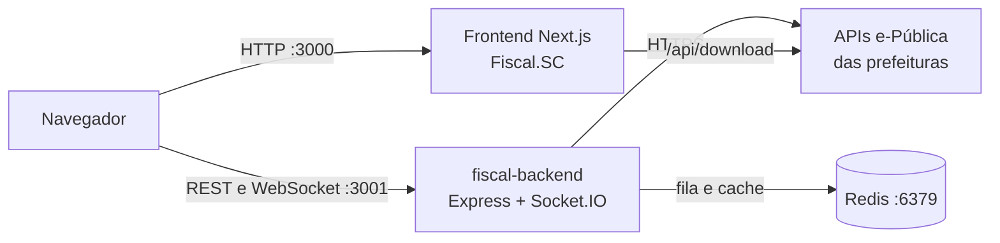

# FiscalSC

Aplicação web gamificada para explorar dados públicos do Poder Executivo de municípios de Santa Catarina.


## Sumário

- [Sobre o projeto](#sobre-o-projeto)
- [O que o projeto não é](#o-que-o-projeto-não-é)
- [Funcionalidades](#funcionalidades)
- [Arquitetura](#arquitetura)
- [Pré-requisitos e execução](#pré-requisitos-e-execução)
- [Estrutura de pastas](#estrutura-de-pastas)
- [Dados e privacidade](#dados-e-privacidade)
- [Limitações conhecidas](#limitações-conhecidas)
- [Trabalhos futuros](#trabalhos-futuros)
- [Contexto acadêmico e como citar](#contexto-acadêmico-e-como-citar)
- [Licença](#licença)

## Sobre o projeto

O FiscalSC apresenta dados públicos do Poder Executivo de quatro municípios catarinenses (Florianópolis, Joinville, Itajaí e Chapecó) para jovens de 18 a 29 anos.

O conteúdo é organizado em nove missões educativas. Cada missão orienta a leitura de um tipo de dado (receitas, despesas, orçamento, licitações, contratos, pessoal, troca de competência, compartilhamento e Lei de Acesso à Informação). A progressão usa XP, níveis e medalhas. Não há ranking entre usuários nem moedas.

A aplicação tem duas condições, **gamificada** e **neutra**, com o mesmo conteúdo. Na condição neutra, os avisos de XP não são exibidos. As duas condições foram implementadas para permitir comparações em estudos futuros.

**Contexto:** produto do Trabalho de Iniciação Científica do curso de Design de Jogos da UNIVALI.
**Orientador:** Dennis Kerr Coelho.
**Autor:** Victor Fineto Silva.

## O que o projeto não é

- Não substitui os portais de transparência oficiais das prefeituras.
- Não emite juízos sobre agentes públicos.
- Não é canal de denúncia.

## Funcionalidades

| Tela | Rota | Conteúdo |
|---|---|---|
| Início | `/` | Nível e XP, percentual de missões concluídas, missões em destaque, atalhos para as abas do painel e medalhas |
| Missões | `/missoes` e `/missoes/[id]` | Catálogo das nove missões e o detalhe de cada uma |
| Executivo | `/gastos` | Lista dos quatro municípios disponíveis |
| Painel do município | `/gastos/municipio/[slug]` | Abas de visão geral, receitas, despesas, orçamento, licitações, contratos e pessoal |
| Conquistas | `/progresso` | Histórico de atividades, medalhas e missões concluídas |
| Meu Perfil | `/pesquisa` | Troca entre as condições gamificada e neutra, reinício do progresso e exportação dos eventos registrados em JSON |

Os valores de `[slug]` são `florianopolis`, `joinville`, `itajai` e `chapeco`.

No painel de licitações, os documentos anexos são baixados por meio da rota `/api/download` do Next.js, que aceita apenas os domínios dos portais.

Também existem duas rotas com dados de demonstração, que não vêm das APIs das prefeituras. Nenhuma página leva a elas (ver [Limitações conhecidas](#limitações-conhecidas)):

- `/gastos/estado`
- `/gastos/[id]`

## Arquitetura



O navegador carrega a interface do frontend e consulta o backend diretamente. O backend monta o painel de cada município a partir das APIs das prefeituras e guarda o resultado no Redis.

| Tecnologia | Para que serve no projeto |
|---|---|
| [Next.js](https://nextjs.org/) 15.5 | Framework React que gera as páginas e também executa rotas de API no servidor. Aqui ele serve a interface e a rota `/api/download`. |
| [React](https://react.dev/) 19.2 | Biblioteca para montar a interface a partir de componentes. |
| [Tailwind CSS](https://tailwindcss.com/) 4.3 | Biblioteca de classes utilitárias de CSS usada para os estilos. |
| [Express](https://expressjs.com/) 5.2 | Framework HTTP para Node.js. É a base da API do `fiscal-backend`. |
| [Socket.IO](https://socket.io/) 4.8 | Canal WebSocket pelo qual o backend envia o painel ao navegador quando a montagem termina. |
| [BullMQ](https://docs.bullmq.io/) 6.3 | Fila de tarefas sobre o Redis. Organiza as consultas por município e aplica o limite de requisições. |
| [Redis](https://redis.io/) | Banco de dados em memória usado como cache e como armazenamento da fila. A imagem Docker é `redis:alpine`, sem versão fixada. |
| [Docker](https://www.docker.com/) | Ferramenta que executa cada serviço em um contêiner isolado. O `docker-compose.yml` sobe os três serviços juntos. |
| e-Pública | Plataforma de portais de transparência usada pelas quatro prefeituras. O backend consulta a API REST pública dela (`/rest/{municipio}/api/v1/...`). |

As versões acima são as registradas nos arquivos `package-lock.json`.

### Rotas da API do backend

| Método | Rota | Função |
|---|---|---|
| GET | `/api/health` | Verificação de funcionamento |
| GET | `/api/dashboard/:cityId?periodo=MM/AAAA` | Painel consolidado do município (rota usada pelo frontend) |
| GET | `/api/query` | Consulta direta a um módulo, com cache |
| POST | `/api/query` | Consulta a um módulo, enfileirada quando há o cabeçalho `x-socket-id` |
| POST | `/api/aggregate` | Agregação trimestral de receitas |

Quando a requisição traz o cabeçalho `x-socket-id`, o backend responde `202`, processa a tarefa na fila e envia o resultado pelo WebSocket. Sem esse cabeçalho, a resposta é síncrona.

## Pré-requisitos e execução

### Opção 1: Docker Compose

Pré-requisito: [Docker](https://docs.docker.com/get-docker/) com o plugin Compose.

```bash
git clone https://github.com/Mertijis/FiscalSC.git
cd FiscalSC
docker compose up --build
```

O Compose sobe três serviços:

| Serviço | Contêiner | Porta |
|---|---|---|
| `redis` | `fiscal-redis` | 6379 |
| `backend` | `fiscal-backend` | 3001 |
| `frontend` | `fiscal-frontend` | 3000 |

Depois que os serviços subirem:

- Interface: <http://localhost:3000>
- Verificação do backend: <http://localhost:3001/api/health>

Para encerrar:

```bash
docker compose down
```

Os dois serviços Node rodam em modo de desenvolvimento (`npm run dev`) sobre a imagem `node:20-alpine`, com o código-fonte montado como volume.

### Opção 2: sem Docker para o Node

Pré-requisitos: Node.js com npm e um Redis acessível em `localhost:6379`. O repositório não define uma versão mínima de Node. As imagens Docker usam Node 20. A inicialização do backend e do frontend também foi testada com Node 24.22.0.

1. Suba apenas o Redis. Se o Docker estiver disponível, use o Compose do backend:

   ```bash
   cd fiscal-backend
   docker compose up -d
   ```

   Esse arquivo também publica a porta 6379, então não o use ao mesmo tempo que o `docker-compose.yml` da raiz.

2. Inicie o backend:

   ```bash
   cd fiscal-backend
   cp .env.example .env
   npm install
   npm run dev
   ```

3. Em outro terminal, inicie o frontend:

   ```bash
   cd Fiscal.SC
   npm install
   npm run dev
   ```

4. Acesse <http://localhost:3000>.

### Variáveis de ambiente

**Backend** (`fiscal-backend/.env`, modelo em `fiscal-backend/.env.example`):

| Variável | Padrão no código | Descrição |
|---|---|---|
| `PORT` | `3001` | Porta HTTP e WebSocket do backend |
| `REDIS_URL` | `redis://localhost:6379` | Endereço do Redis. No Compose, vale `redis://redis:6379`. |

**Frontend** (`Fiscal.SC/.env.local`, modelo em `Fiscal.SC/.env.example`):

| Variável | Padrão no código | Descrição |
|---|---|---|
| `NEXT_PUBLIC_WORKER_URL` | `http://localhost:3001` | Endereço do backend usado pelo navegador para REST e WebSocket |

Nenhuma variável é obrigatória para a execução local, pois todas têm valor padrão.

O `docker-compose.yml` também define `NEXT_PUBLIC_BACKEND_URL` e `NEXT_PUBLIC_SOCKET_URL` para o frontend, mas o código não lê essas variáveis.

Ao iniciar, o backend pré-carrega no cache os painéis dos quatro municípios para o período `10/2026`, que é fixo no código. Quando a requisição não informa `periodo`, a API usa `01/2024`.

### Outros scripts

```bash
cd Fiscal.SC
npm run typecheck   # verificação de tipos com o TypeScript
npm run build       # build de produção do Next.js
npm run test:api    # executa a coleção Bruno contra a API de Florianópolis
```

O script `test:api` faz requisições à API pública de Florianópolis e não testa o código do projeto.

## Estrutura de pastas

```text
FiscalSC/
├── docker-compose.yml        # Redis, backend e frontend
├── LICENSE
├── Fiscal.SC/                # Frontend (Next.js)
│   ├── app/                  # Páginas e a rota /api/download
│   ├── components/           # Componentes de interface e do painel do Executivo
│   ├── data/                 # Missões, medalhas e lista de municípios
│   ├── hooks/                # Conexão com o backend via Socket.IO
│   ├── lib/                  # Cliente da API do backend
│   └── bruno/                # Coleção Bruno para a API e-Pública
└── fiscal-backend/           # Backend (Express)
    ├── docker-compose.yml    # Somente Redis, para execução sem Docker no Node
    └── src/
        ├── adapters/         # Endereços e parâmetros da API e-Pública por município
        ├── controllers/      # Tratamento das requisições
        ├── queues/           # Filas BullMQ e limite de requisições
        ├── redis/            # Cliente Redis e funções de cache
        ├── routes/           # Rotas /api
        ├── services/         # Montagem e normalização do painel
        └── socket/           # Servidor Socket.IO
```

## Dados e privacidade

- Os dados financeiros e de pessoal do painel do município vêm das APIs oficiais dos portais de transparência das prefeituras. Os valores não são estimados. As exceções são as rotas de demonstração descritas em [Limitações conhecidas](#limitações-conhecidas).
- O progresso do usuário (condição, missões, ações e eventos) e o perfil do participante (apelido, idade e residência) ficam apenas no `localStorage` do navegador. Esses dados não são enviados ao servidor. A exportação na tela "Meu Perfil" gera um arquivo JSON no próprio navegador.
- A aba de pessoal exibe dados fornecidos pelas prefeituras: nome, CPF parcial e remuneração dos servidores. Esses dados ficam guardados somente no Redis, por 24 horas.
- O projeto não coleta dados pessoais de usuários.

## Limitações conhecidas

- **Totais parciais.** Cada módulo consulta no máximo um número fixo de registros por requisição, sem paginação. Quando o limite é atingido, os totais exibidos são parciais.

  | Módulo | Limite por requisição |
  |---|---|
  | Receitas | 1000 |
  | Despesas | 1000 |
  | Orçamento (despesa orçamentária) | 1000 |
  | Pessoal | 500 |
  | Contratos | 200 |
  | Licitações | 50 |

- **Cálculos próprios.** Os valores de execução orçamentária (empenhado, liquidado e pago) vêm de uma classificação própria dos movimentos informados pela API. No total de receitas arrecadadas, um registro com arrecadação líquida negativa entra como zero, mas a lista da aba de receitas mostra esse registro com o valor negativo. A folha de pessoal recorre ao mês anterior quando o mês consultado vem sem valores.
- **Limite de requisições.** O backend limita a fila de cada município a 400 tarefas por minuto. Esse limitador conta tarefas, não requisições às fontes: a montagem de um painel é uma tarefa, mas faz de 6 a 7 consultas. As chamadas síncronas (sem `x-socket-id`) não passam pela fila.
- **Cache.** O painel montado fica em cache por 24 horas. A consulta bruta de licitações expira em 15 minutos, e os links de download dos documentos podem vencer.
- **Licitações de Florianópolis** cobrem apenas os dias 1 a 15 do mês consultado.
- **Falhas parciais não sinalizadas.** Quando só parte dos módulos falha, a interface não avisa. O erro `502` (`MUNICIPIO_INDISPONIVEL`) aparece apenas quando todas as consultas falham.
- **Sem testes automatizados** do código e sem verificação sistemática dos valores contra os portais oficiais.
- **Sem hospedagem externa.** O sistema roda localmente.
- **Contraste.** Parte da interface tem pares de cores com contraste insuficiente (pontuação de acessibilidade no Lighthouse: 96 [CONFIRMAR: a pontuação não está registrada no repositório]).
- **Sem links para os registros.** A interface não exibe links diretos para os registros nos portais oficiais. Só é possível baixar os documentos anexos das licitações.
- **Dados de demonstração.** Algumas telas e campos não vêm das APIs:
  - A rota `/gastos/estado` mostra valores fixos de Santa Catarina.
  - A rota `/gastos/[id]` usa registros de demonstração de `data/content.ts`.
  - A pontuação (`score`) que ordena os municípios em `/gastos` é fixa, em `data/municipalities.ts`.

  Nenhuma página leva às duas rotas.

## Trabalhos futuros

- Coletar todos os registros por paginação ou consultas divididas. A coleta deve respeitar o limite de 400 requisições por minuto das fontes, contando cada requisição e não cada tarefa. As cargas devem ficar em até cerca de 20 MB, o limite configurado no backend para o Express e o Socket.IO.
- Remover as rotas de demonstração ou trocá-las por dados reais.
- Corrigir os pares de cores com contraste insuficiente.
- Hospedar a aplicação externamente.
- Incluir links para os registros nas fontes oficiais.
- Realizar estudo com usuários comparando as condições gamificada e neutra.

## Licença

Distribuído sob a licença MIT. Consulte o arquivo [LICENSE](LICENSE).
